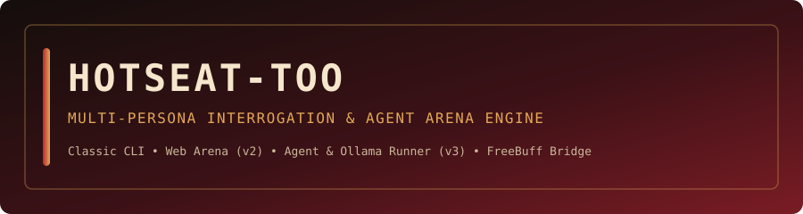

<p align="center">
  
</p>

<h1 align="center">The Hot Seat</h1>
<p align="center"><b>One idea. A panel that doesn't flinch. A brief you can build today.</b></p>

<p align="center">
  
  
  <a href="https://github.com/BleakNarratives/a9-Hotseat-Too/actions/workflows/tests.yml"></a>
  
</p>

**Hotseat-Too** is a local-first AI pressure cooker: a small cast of sharply drawn
personas interrogates an idea, a decision, or a build until something true falls
out. It runs on a phone in Termux with Ollama, on a laptop with zero dependencies,
or against any cloud model with your own key.

One session. Structured turns. A closer who speaks last and short. Persistent
memory. Structured events for your own frontend. No phases to schedule, no
document chain to carry between chats.

---

## Twenty seconds, no key

```bash
git clone https://github.com/BleakNarratives/a9-Hotseat-Too
cd a9-Hotseat-Too
python -m hotseat_core --provider demo "a CLI that turns a voice memo into tasks"
```

```text
==============================================================
  THE HOT SEAT — Classic — the idea audit
  a CLI that turns a voice memo into tasks
==============================================================
“a CLI that turns a voice memo into tasks” assumes the hard part is the build. It
is the Tuesday after. The wire is quiet for this case, which is itself a
finding. Decide who owns it then, or stop calling it a product.
_(demo output — no model was called)_

“a CLI that turns a voice memo into tasks” solves the visible problem. The one
underneath is distribution. The wire is quiet for this case, which is itself a
finding. Fix the front door before you add another room.

Ship the smallest version of “a CLI that turns a voice memo into tasks” this
week. The wire is quiet for this case, which is itself a finding. Stop planning.
```

The demo provider is deterministic and labeled on purpose. It composes every
turn from your actual pitch and any scout evidence in the prompt — prices,
competitors, signal headlines — instead of replaying a fixed script, and never
calls a model. It exists so the UI and the contract can be exercised before
anyone buys a token.

## Modes

| Mode | Cast | Use it for |
| :--- | :--- | :--- |
| `arena` | Producer → Critic → Foreman → Architect → Coroner | Your idea vs three generated rivals |
| `classic` | Dame Audrey (auditor) → Claib (market) → Vertical AI (closer) | Ideas, pitches, “is this stupid?” |
| `v2` | Three skeptics → a volunteer defending the idea | Debate; `--statement` sets the defence |
| `v3 panel` | Marlowe (witness) → Priya (systems) → Zero (closer) | Personal decisions and life inventory |
| `v3 tribunal` | Adversary, Reason, Whistleblower, Evangelist → Fixer | Decisions that need three ranked actions |
| `bmad` | Analyst → PM → Architect → Builder → QA | A build brief in one pass |

```bash
python -m hotseat_core --list-modes
python -m hotseat_core --list-personas bmad
python -m hotseat_core --mode v3 --variant tribunal "hire or contract?"
```

## Your idea vs three rivals

The arena is the front door: your idea is contender zero, and the panel generates
three rivals for the same customer and job — cheaper, premium, and a niche wedge.
They are cross-examined, ranked, and one is voted off. The winner gets a build
brief; yours gets an autopsy either way.

```bash
python -m hotseat_core --mode arena "a CLI that turns a voice memo into tasks" \
  --constraint "budget $0" --constraint "one weekend"
```

1. **The Producer** builds four fair contenders, each with a bet, price, wedge,
   first ten customers, and the assumption it dies on.
2. **The Critic** cross-examines all four.
3. **The Foreman** ranks and eliminates one, with the deciding difference.
4. **The Architect** gives the survivor a vertical-slice build brief.
5. **The Coroner** writes the autopsy: what killed your idea, and the smallest
   change that would have saved it.

Five turns, one session, no scores out of 100. It is also the practical front door
to a Vertical AI boardroom: the same cast, memory, and event stream in one command.

## BMAD without the ceremony

BMAD's roles are useful. Its phase gates, PRD handoffs, story files, and agent
ceremonies are not — they cost sessions before any code exists. `bmad` mode keeps
the roles and the artifacts that matter, and compresses them into a **single
five-turn pass**:

```bash
python -m hotseat_core --mode bmad "a local-first CLI that turns a voice memo into a task list"
```

1. **Analyst** — user, evidence, assumptions, and the assumption that kills it.
2. **PM** — one-sentence product, three must-haves, non-goals, metric, smallest slice.
3. **Architect** — the vertical slice, interfaces, storage, risky dependency, deferrals.
4. **Builder** — first story: files, interfaces, first test, timebox, done today.
5. **QA** — three acceptance checks, two kill criteria, what to cut, GO/NO-GO.

Output is a Markdown transcript you can save as the brief. No interviews, no
templates, no second session to “generate the architecture document.” If the
brief is wrong, you learned it in five model turns instead of five hours.

## Real models

### Local (the original habitat)

```bash
ollama serve
ollama pull deepseek-r1:1.5b llama3.2:1b deepseek-coder:1.3b

python -m hotseat_core --provider ollama --mode classic "my idea"
python -m hotseat_core --provider ollama --mode bmad "the thing I want to build"
```

Defaults are 1–1.5B models on purpose — see
[the model routing notes](docs/LEGACY_NOTES.md#model-routing-learned-on-a-phone).

### Cloud

Keys resolve automatically from the environment, a repo-root `.env`, or
`~/.concierge/vault.json` via
[`hotseat_core/vault_loader.py`](hotseat_core/vault_loader.py) — no exports or
CLI prefixes required. The vault is searched recursively, provider/key matching
is case-insensitive, and aliases such as `OPENROUTER_KEY` work.

```bash
# ~/.concierge/vault.json can be nested in any of these shapes:
# {"keys": {"OPENROUTER_KEY": "..."}, "mistral": {"api_key": "..."}}
# {"providers": {"anthropic": {"token": "..."}}}
# {"secrets": [{"name": "GROQ_API_KEY", "value": "..."}]}

python3 -m hotseat_core --provider openrouter --mode arena "my idea"
python3 -m hotseat_core --provider mistral --mode bmad "the thing I want to build"
```

`.env` is ignored by Git. Nothing is hardcoded, and no key is read for a provider
you did not select.

Providers are resilient by default: a 429, 5xx, timeout, or connection failure
falls through to the next configured cloud key, and the backup becomes sticky for
the rest of the session. `GET /providers/status` reports presence (never values)
so a frontend can disable unconfigured providers.

Route models per role instead of forcing one model across the room:

```bash
python3 -m hotseat_core --mode arena \
  --role-model producer=fast-model \
  --role-model critic=fast-model \
  --role-model foreman=strong-reasoner \
  --role-model architect=strong-reasoner \
  --role-model coroner=strong-reasoner \
  "my idea"
```

Custom casts send `"mode": "custom"` plus `"cast": ["arena:producer", ...]`
(1–8 ids, resolved from `GET /personas`). One turn per persona, in order.

The same map is accepted as `role_models` on `POST /sessions`; `manifest.json`
persona overrides continue to work for durable defaults, and role defaults can be
stored as `"role_models": {"arena": {"producer": "fast-model"}}` under
`hotseat_core`.

| Provider | Notes |
| :--- | :--- |
| `auto` | Probe local 9router → first configured cloud key → OpenRouter default; billing/rate-limit/server failures fall through to the next configured key |
| `ollama` | Local, no key; `OLLAMA_BASE_URL` to override |
| `9router`, `ai_gateway` | Local OpenAI-compatible routers |
| `openrouter`, `gemini`, `mistral`, `cerebras`, `groq`, `anthropic` | Cloud; env or vault |
| `demo` | Offline replies composed from the pitch and scout evidence; docs and tests |

Current cloud defaults: OpenRouter `openai/gpt-4o-mini`, Gemini
`gemini-3.8-flash`, Mistral `mistral-small-latest`, Cerebras `gpt-oss-120b`,
and Groq `openai/gpt-oss-120b`. Override any of them with
`OPENROUTER_MODEL`, `GEMINI_MODEL`, `MISTRAL_MODEL`, `CEREBRAS_MODEL`, or
`GROQ_MODEL`.

### What the voice costs

Nothing, as shipped. Dictation uses the browser's speech recognizer and
read-aloud uses its installed voices; there is no audio API, no key, and no
per-minute bill. The trade is quality: browser voices are serviceable, not
studio character acting. If you later want real character voices, Piper or
Kokoro can run self-hosted for free (CPU, extra memory) and ElevenLabs is the
paid ceiling. For the panel itself, a free Gemini, Groq, Cerebras, or
OpenRouter key is enough to leave demo mode; Mistral needs an activated API
budget on your account. Ollama is the fully local option.

## The live arena console

`--serve` hosts a zero-dependency web UI at **http://127.0.0.1:8765** — no
build step, no terminal required after the one command:

```bash
python3 -m hotseat_core --serve --provider demo
# open http://127.0.0.1:8765          the room
# open http://127.0.0.1:8765/console  the war room
```

The retro war room at `/console` is wired to the bridge contract: mode and
provider selectors, seed prompt and constraint tags, push-to-talk dictation (Web
Speech API with a text fallback), a live four-contender bracket, critic feed,
Foreman callout, build brief, Coroner autopsy, and threaded follow-ups against
the active session. It reads the real time/token/persona event stream over SSE
and reconnects with an event offset instead of replaying duplicates.

**Scout Wire** runs across the top: live ChronoScouts signals, competitor price
points, and structured market anchors, with a drawer for source health and a
**Pull fresh intel** button. The FreeBuff-purple **Switchboard** theme is one
click away from the maroon terminal theme. Provider status badges show which
keys the bridge discovered, the role drawer routes models per persona, and
**Export brief** downloads the bracket, Architect slice, and Coroner autopsy as
one Markdown file.

Phones and tablets get a dedicated companion at **http://127.0.0.1:8765/m**.
It keeps the same bridge and SSE contract but replaces the dense war-room grid
with a three-state flow: setup, live, and verdict. Setup uses constraint chips and
a sticky Convene button; live has a speaker spotlight, five-step progress rail,
swipeable contenders, segmented detail tabs, and a Scout Intel bottom sheet; the
verdict starts with the winner and offers Share, Copy Markdown, and Download .md.
The war room at `/console` auto-redirects below 768px unless `?desktop=1` is
present, and every shell links back to the room and the companion.

**The Table** at `/` is the front door and the character-first cut of the same
session: no control panel, no progress rail. Cartoon personas sit around a
boardroom table, the idea is a case file you type into, and turns arrive as
speech bubbles. Click a character to have them hand you their dossier (role,
model, last turn); the speaking seat lights up and the rest of the room dims.
The gavel stops a session, the paper strip downloads the transcript, and
follow-ups appear as a note passed across the table. The **wire** card shows the
live scout sweep behind the case — signal count, competitor prices — and opens
for the headlines. The paper **program** card
recasts the room for any format — arena, audit, debate, panel, tribunal, brief —
so nobody needs a terminal flag to pick a show.

The **call sheet** goes further: check any one to five of the 25 personas from
every format, including both Architects, and the room runs them in the order you
picked. The **dial** sets how loose the room gets — clinical at 0, measured in
the middle, unhinged at 11 — and **ROLL** drops it somewhere random. The mic on
the case file dictates the pitch through the browser's speech recognizer;
**VOICE** reads finished turns aloud, with a different installed voice plus
pitch and rate mapped to each character. Dictation needs Chrome, Edge, or Safari
over HTTPS. Read-aloud uses whatever voices the machine already has, so the
quality is the browser's, not a studio's. Exact syntax, provider routing,
and Scout Wire stay in `/console`; `/table` is an alias for the same room.

## Live ChronoScouts & market intel

Every arena run can carry real, timestamped market evidence into the Producer,
Critic, Foreman, Architect, and Coroner prompts:

```bash
# Local ChronoScouts export (dist/signals_export.json or scout_rag_store.db)
python3 -m hotseat_core --mode arena --scout-feed --scout-offline "my idea"

# Local + live Hacker News, RSS, and pricing scouts
CHRONOSCOUTS_DIR=~/ChronoScouts python3 -m hotseat_core --mode arena \
  --scout-feed "my idea" \
  --scout-url "https://example.com/feed.xml" \
  --pricing-url "https://competitor.example/pricing"
```

Local SQLite is opened with `?mode=ro`; nothing is written back. Signals carry a
temporal-decay weight (`0.5 ** (age_days / half_life)`). Live sources are
best-effort: a blocked feed is reported in the Scout Wire drawer, never allowed to
kill the session. `HOTSEAT_SCOUT_RSS` and `HOTSEAT_PRICING_URLS` add defaults.

Signals, SQLite rows, RSS entries, and pricing pages are parsed into a
`market_anchors` block: competitor, product, amount, currency, `monthly` /
`yearly` / `one_time` / `custom` period, and `freemium` / `paid` / `enterprise`
tier. The same structured block is returned by `/scouts/latest` and injected into
the Producer and Critic prompts.

## Bring your own frontend

A stdlib HTTP + SSE bridge, no scraping stdout, no Gradio:

```bash
python -m hotseat_core --serve --provider demo
curl -s -XPOST localhost:8765/sessions \
  -H 'Content-Type: application/json' \
  -d '{"mode":"bmad","topic":"ship it or bin it?"}'
curl -N localhost:8765/sessions/<session_id>/events
curl -s localhost:8765/scouts/latest
```

Modes, personas, providers, provider credential status, history, and scout reports are queryable; personas
are editable for the running process; operator notes can be injected between
turns; sessions can be stopped or continued with a threaded follow-up. Events:
`session_start`, `status`, `token_chunk`, `persona_turn`, `operator_message`,
`iteration_start`, `memory_saved`, `error`, `session_end`.

Full schemas and a working EventSource client:
**[FRONTEND_CONTRACT.md](FRONTEND_CONTRACT.md)**.

The CLI streams the same events:

```bash
python -m hotseat_core --mode bmad --json-stream "the thing" | jq -r 'select(.type=="persona_turn") | .content'
```

## Layout

```
hotseat_core/
  config.py       manifest + env resolution, no side effects on import
  personas.py     casts, routing, limits, overrides
  providers.py    urllib transport (OpenAI-compatible, Anthropic, Ollama) + demo
  vault_loader.py recursive vault + repo .env credential resolution
  scouts_feed.py  ChronoScouts JSON/SQLite + HN/RSS/pricing collectors
  tuning.py       composable style directives and sampling; filler cleanup
  storage.py      SQLite memory + JSONL log, in-place legacy migration
  engines/        classic · v2_web · v3_agent · bmad · arena · followup
  runtime.py      orchestration, events, persistence, threaded follow-ups
  cli.py          python -m hotseat_core
  bridge.py       HTTP/SSE/NDJSON adapter + static console serving
web/              zero-dependency war room + /m companion shell
tests/            61 tests, stdlib only
docs/             extracted legacy context, decisions, and the unbuilt show concept
```

That is the whole tracked project. The old trees were read, their durable ideas
captured in [docs/LEGACY_NOTES.md](docs/LEGACY_NOTES.md), and removed from the
working tree. They remain in Git history (`git show e96909a:hotseat_v2/app.py`);
nothing was lost, and the repository is now one vertical slice instead of four
overlapping ones.

## Memory

* `~/hotseat/memory.db` — SQLite, normalized sessions; old persona-column rows are
  reconstructed automatically.
* `~/hotseat/sessions.log` — append-only JSONL; legacy `timestamp | topic` lines
  are still parsed.
* Override with `--data-dir`, `--db`, `HOTSEAT_DATA_DIR`, or `HOTSEAT_DB`.

```bash
python -m hotseat_core --history --limit 5
```

## Style

`--style nosyco,terse` composes prompt directives with sampling changes
(temperature, top-p, penalties, token caps). Personas can be overridden in
`manifest.json` or per run.

This is voice and structure control, not model surgery: no weight changes, no
guardrail removal, no provider-policy bypass. If a model refuses, that is the
model's policy — pick a model whose policy fits the job.

## Tests

```bash
python -m unittest discover -s tests -t . -v
```

Covered: manifest/env precedence, nested vault and `.env` resolution, per-role
model routing, 429/timeout fallback routing, provider-status credential presence
without secret values, persona resolution and overrides, legacy SQLite migration,
JSONL and legacy logs, every engine including `bmad` and `arena`, scout evidence
injection, ChronoScouts JSON/SQLite ingestion, live fetcher parsing, structured
market anchors, threaded follow-ups, NDJSON output, HTTP endpoints, static war
room and `/m` companion routes, token auth, and the loopback-binding guard. CI runs on Python
3.10–3.12.

## Termux

```bash
pkg install python
# Install Ollama for Termux/Android using its current instructions, then:
python -m hotseat_core --provider ollama --mode classic "my idea"
```

## Deploy it for other people

The bridge is one long-lived process serving its own UI, SSE, and API, with live
sessions in memory and SQLite on local disk. That rules out serverless hosts:
Vercel Functions cap a request at 300s on Hobby and give no shared memory or
disk, and Netlify Functions are shorter still. Use a container host instead.

**Render free web service** is the zero-card option: 512 MB / 0.1 CPU, one
instance, a public `onrender.com` URL with TLS, custom domains included.

1. Push this repo to GitHub.
2. Render → **New → Blueprint** → select the repo. `render.yaml` creates the
   service, sets `HOTSEAT_PROVIDER=auto`, and prompts for `HOTSEAT_TOKEN` plus
   the five provider keys. Fill at least one provider key; leave the others
   blank. For a zero-key public demo, set `HOTSEAT_PROVIDER=demo` instead. Use a
   long letters-and-digits token — it travels in a query string, where `+`,
   `&`, `#` and `?` change its meaning.
3. Share `https://<service>.onrender.com/?token=<passphrase>`. The console
   forwards the token to its fetches and the EventSource; the static shell loads
   without it, every API route needs it. Without `render.yaml`, create a Docker
   web service and set `HOTSEAT_PROVIDER=auto`, `HOTSEAT_TOKEN`, and at least
   one provider key by hand.

`--provider demo` is canned output: safe to expose, costs nothing, and tests the
flow rather than the model. The Blueprint defaults to real providers via
`HOTSEAT_PROVIDER=auto`; add at least one of `OPENROUTER_API_KEY`,
`GEMINI_API_KEY`, `MISTRAL_API_KEY`, `CEREBRAS_API_KEY`, or `GROQ_API_KEY`.
Auto mode starts with the first configured key and falls back on billing,
rate-limit, and server failures; backups use their own default model, so a
per-role model name from one provider will not be sent to another. Keep the
token: it is a shared secret, and every session spends your budget. Cap each
key at the provider, not in the app. Leave the UI provider selector on
**AUTO**, which uses the server configuration.

Known free-tier edges, all by design on Render: the service spins down after 15
idle minutes and takes about a minute to wake, so a session left open can lose
its in-memory job (the SQLite history survives); the filesystem is ephemeral, so
`~/hotseat` resets on every deploy, restart, or spin-down; bandwidth is 5 GB a
month. Upgrade the service to the $7/month plan for always-on without changing
anything else. For a true always-on free VM, Oracle Cloud Always Free offers a
small Arm instance (a card is required for identity verification, and capacity
varies by region); run the same `Dockerfile` there. Fly.io now requires a card
for its free allowance.

### Keep the free room warm with cron-job.org

cron-job.org can GET the public `/` shell every ten minutes; that is ordinary
traffic, so Render does not spin the service down. Only the cron-job.org key is
needed — the Hot Seat bearer token never leaves the app.

1. cron-job.org Console → **Settings** → **API key** → create one.
2. Add `CRONJOB_API_KEY` in the Freebuff Keys tab (or export it).
3. Once the Render URL exists, create or update the job:

```bash
HOTSEAT_PUBLIC_URL=https://<service>.onrender.com \
  python3 -m hotseat_core --cron-setup
```

It creates a job titled **Hot Seat keepalive** that pings `/` every 10 minutes.
`--cron-every 15` changes the interval, and `--cron-list` shows the account's
jobs. The job is a plain GET against the public HTML shell, so it never needs
`HOTSEAT_TOKEN`.

The trade-off: keeping the free instance awake 24/7 uses nearly all of Render's
750 free instance hours for the month. If you would rather let it sleep between
visits, skip this job. The cron-job.org API allows 100 requests a day by
default, so setup and updates are not high-frequency operations. Netlify and
Vercel cannot replace Render here: this app needs one long-lived process for
SSE, in-memory sessions, and SQLite, not short-lived serverless functions.

## Roadmap

- [x] One package: classic, v2, v3 panel/tribunal, BMAD-lite, and Arena
- [x] Zero-dependency core, provider layer, safe demo mode
- [x] Structured NDJSON + HTTP/SSE bridge and frontend contract
- [x] Extract legacy context, remove the bulk
- [x] Arena: seed vs three rivals, cross-exam, vote-off, brief, autopsy
- [x] Live retro web console, Scout Wire, threaded follow-ups
- [x] Live ChronoScouts + market/pricing evidence in arena prompts
- [x] Per-role model routing + automatic provider fallback
- [x] Provider status badges, role drawer, Markdown brief export
- [x] Phone/tablet companion shell at `/m`
- [ ] Full season: eight-character roster, user-built persona, escalation arc
- [ ] Private and duo sessions, and the cross-remark engine
- [ ] Optional embedding recall across sessions

## Why star it

Because the whole thing is a vertical slice: one developer, a phone, a real
problem, and a repo you can read in a sitting. If it kills one bad idea cheaply —
or briefs one good build in five turns — star it, open an issue with a transcript,
or send a PR against the contract.

Built by [@BleakNarratives](https://github.com/BleakNarratives) (Michael Talbert,
Wellington, Kansas). Originally written for Android/Termux with local Ollama.
